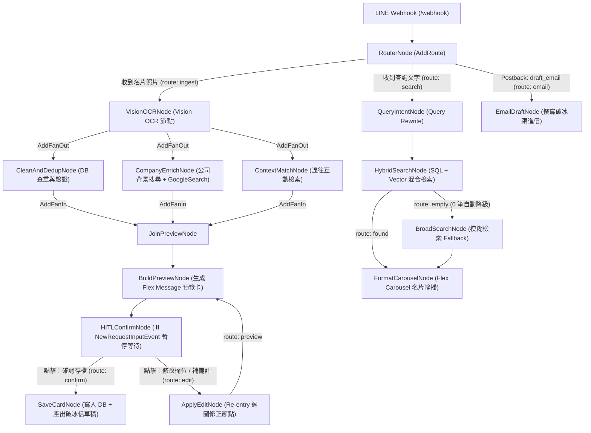

# LINE Card Assistant (`line-card-assistant`)

An intelligent **LINE Bot Business Card Assistant** written in Go, powered by **Google ADK 2.0 Graph Workflows (`google.golang.org/adk/v2`)**, **Gemini / Vertex AI Agent Platform (`google.golang.org/genai`)**, and **LINE Messaging API SDK v8 (`github.com/line/line-bot-sdk-go/v8`)**.

---

## ✨ Key Features

- **Multimodal Vision OCR (`VisionOCRNode`)**: Upload a business card photo in LINE to automatically extract structured fields (`Name`, `Title`, `Company`, `Email`, `Phone`, `Address`, `Website`, `TaxID`).
- **ADK 2.0 Parallel Fan-Out / Fan-In Enrichment (`AddFanOut` / `AddFanIn`)**:
  - **`CleanAndDedupNode` [DB 查重與驗證]**: Normalizes Taiwan phone numbers (`09xx-xxx-xxx` $\rightarrow$ `+886-9xx-xxx-xxx`) and checks `CardStore` for existing contacts or job title promotions.
  - **`CompanyEnrichNode` [公司背景搜尋]**: Runs an ADK `llmagent` equipped with `geminitool.GoogleSearch{}` to summarize the company's core business and generate 3–5 industry tags.
  - **`ContextMatchNode` [過往互動檢索]**: Infers the meeting event/context (`MetContext`, e.g., `2026 Cloud Summit Taipei`) from recent user messages.
- **Human-in-the-Loop (HITL) Confirmation & Cyclic Edit Loop**:
  - Pauses workflow execution using `workflow.NewRequestInputEvent` and sends an interactive **LINE Flex Message Bubble** preview with two action buttons:
    - **「✅ 確認存檔」** (`action=confirm_save` / `action=confirm`) $\rightarrow$ Routes to `SaveCardNode` **[寫入 DB + 產出破冰信草稿]**.
    - **「✏️ 修改欄位 / 補備註」** (`action=edit` with `openKeyboard` or direct text reply like `「他名字是王太明，在 DevFest 認識的」`) $\rightarrow$ Routes to `ApplyEditNode` **[Re-entry 迴圈修正節點]** $\rightarrow$ loops back to `BuildPreviewNode` $\rightarrow$ `HITLConfirmNode`.
- **Natural Language Hybrid Search & Flex Carousel**:
  - **Query Rewrite (`QueryIntentNode`)**: Converts conversational queries (e.g., `「幫我找上週在 Cloud Summit 認識做 AI 的人」`) into structured `SearchFilter` criteria.
  - **SQL + Vector / Keyword Hybrid Search (`HybridSearchNode` + `BroadSearchNode`)**: Runs strict structured + semantic keyword matching with automatic fallback to fuzzy token scoring.
  - **Flex Carousel (`FormatCarouselNode`)**: Renders up to 5 cards in a **LINE Flex Message Carousel** with one-tap `tel:`, `mailto:`, and **「✉️ 撰寫破冰跟進信」** (`action=draft_email&card_id=<id>`) actions.
- **Cloud Run Self-Identity (ADC) & Agent Platform API Key Support**:
  - Supports **Cloud Run Service Account Self-Identity (Application Default Credentials)** on Vertex AI (`GOOGLE_GENAI_USE_VERTEXAI=true`), **Vertex AI / Agent Platform API Key**, **Gemini API Key**, and zero-config **Dry-Run MockLLM Mode** for local testing.

---

## 🏗️ Workflow Architecture

### 1. System Flowchart

```text
[LINE Webhook] 
      │
      ▼
[Router Node (AddRoutes)]
  ├── (收到名片照片) ──► [Vision OCR 節點] 
  │                           │
  │                    (AddFanOut 平行處理)
  │            ┌──────────────┼──────────────┐
  │            ▼              ▼              ▼
  │     [DB 查重與驗證]  [公司背景搜尋]  [過往互動檢索]
  │            └──────────────┼──────────────┘
  │                    (AddFanIn 匯聚)
  │                           ▼
  │              [生成 Flex Message 預覽卡]
  │                           │
  │            ⏸️ NewRequestInputEvent (HITL 暫停等待)
  │                           │
  │      ┌────────────────────┴────────────────────┐
  │      ▼ (點擊：確認存檔)                         ▼ (點擊：修改欄位 / 補備註)
  │ [寫入 DB + 產出破冰信草稿]              [Re-entry 迴圈修正節點]
  │
  └── (收到查詢文字) ──► [Query Rewrite] ──► [SQL + Vector 混合檢索] ──► [Flex Carousel 名片輪播]
```

### 2. Mermaid Graph Diagram



### 3. Flowchart-to-Code Mapping

| 流程圖節點 | 對應程式碼節點 / 函式 | 檔案位置 |
| :--- | :--- | :--- |
| `[LINE Webhook]` | `Handler.ServeHTTP` | `internal/linebot/handler.go` |
| `[Router Node (AddRoutes)]` | `RouterNode` + `eb.AddRoute(...)` | `internal/workflow/graph.go`, `internal/workflow/nodes_ingest.go` |
| `[Vision OCR 節點]` | `VisionOCRNode` (`newVisionOCRNode`) | `internal/workflow/nodes_ingest.go` |
| `(AddFanOut 平行處理)` | `eb.AddFanOut(visionOCRNode, ...)` | `internal/workflow/graph.go` |
| `[DB 查重與驗證]` | `CleanAndDedupNode` (`newCleanAndDedupNode`) | `internal/workflow/nodes_ingest.go` |
| `[公司背景搜尋]` | `CompanyEnrichNode` (`llmagent` + `geminitool.GoogleSearch{}`) | `internal/workflow/nodes_ingest.go` |
| `[過往互動檢索]` | `ContextMatchNode` (`newContextMatchNode`) | `internal/workflow/nodes_ingest.go` |
| `(AddFanIn 匯聚)` + `[生成 Flex Message 預覽卡]` | `eb.AddFanIn(...)` $\rightarrow$ `BuildPreviewNode` | `internal/workflow/graph.go`, `internal/workflow/nodes_ingest.go` |
| `⏸️ NewRequestInputEvent (HITL 暫停等待)` | `HITLConfirmNode` (`workflow.NewRequestInputEvent`) | `internal/workflow/nodes_ingest.go` |
| `[寫入 DB + 產出破冰信草稿]` | `SaveCardNode` (`cardStore.Save` + `generateDraftEmail`) | `internal/workflow/nodes_ingest.go` |
| `[Re-entry 迴圈修正節點]` | `ApplyEditNode` $\rightarrow$ `BuildPreviewNode` | `internal/workflow/nodes_ingest.go` |
| `[Query Rewrite]` | `QueryIntentNode` (`newQueryIntentNode`) | `internal/workflow/nodes_search.go` |
| `[SQL + Vector 混合檢索]` | `HybridSearchNode` + `BroadSearchNode` | `internal/workflow/nodes_search.go`, `internal/store/memory.go` |
| `[Flex Carousel 名片輪播]` | `FormatCarouselNode` (`BuildSearchCarouselFlexJSON`) | `internal/workflow/nodes_search.go`, `internal/linebot/flex.go` |

---

## 📂 Project Structure

```text
.
├── cmd/
│   └── server/
│       └── main.go                 # HTTP server entrypoint (/webhook, /healthz)
├── internal/
│   ├── config/
│   │   └── config.go               # Env var loader (Cloud Run Self-Identity ADC, Vertex AI & API keys)
│   ├── models/
│   │   └── card.go                 # BusinessCard, SearchFilter, CardWorkflowState
│   ├── store/
│   │   ├── store.go                # CardStore / CardRepository interface
│   │   └── memory.go               # Thread-safe in-memory store with 4 seeded Taiwan cards
│   ├── workflow/
│   │   ├── graph.go                # ADK 2.0 Graph Workflow builder, runner & MockLLM
│   │   ├── nodes_ingest.go         # Ingestion, Fan-Out/Fan-In, HITL & Edit Loop nodes
│   │   ├── nodes_search.go         # Search intent, Hybrid/Broad search, Carousel & Email nodes
│   │   └── graph_test.go           # End-to-end ADK 2.0 workflow & HITL unit tests
│   └── linebot/
│       ├── handler.go              # LINE Messaging API v8 webhook handler
│       ├── handler_test.go         # Webhook integration tests
│       └── flex.go                 # Flex Message Bubble & Carousel JSON builders
├── Dockerfile                      # Multi-stage Cloud Run ready container image
├── Makefile                        # build, run, test, fmt targets
└── README.md
```

---

## ⚙️ Environment Variables

| Variable | Description | Default |
| :--- | :--- | :--- |
| `PORT` | HTTP server port | `8080` |
| `LINE_CHANNEL_SECRET` | LINE Messaging API Channel Secret | *(Dry-Run if empty)* |
| `LINE_CHANNEL_ACCESS_TOKEN` | LINE Messaging API Channel Access Token | *(Dry-Run if empty)* |
| `GEMINI_MODEL` | Gemini model name | `gemini-3.8-flash` |
| `GOOGLE_GENAI_USE_VERTEXAI` | Set to `true` (or `1`) to use Vertex AI / Agent Platform backend | `false` (auto `true` if `GOOGLE_CLOUD_PROJECT` is set) |
| `GOOGLE_CLOUD_PROJECT` | GCP Project ID for Cloud Run Self-Identity (ADC) | *(Auto-detected on Cloud Run via Metadata Server)* |
| `GOOGLE_CLOUD_LOCATION` | Vertex AI location/region | `global` |
| `AGENT_PLATFORM_API_KEY` | Optional Agent Platform / Vertex AI Express API Key | *(Uses Self-Identity ADC if omitted on Vertex AI)* |
| `GOOGLE_API_KEY` | Optional Gemini Developer API Key | *(MockLLM if neither ADC nor API Key is set)* |

---

## ☁️ Deploying to Google Cloud Run (Self-Identity / Vertex AI Agent Platform)

### Option A: Cloud Run Self-Identity (Recommended — Zero API Key via Service Account ADC)

When deployed on Cloud Run with `GOOGLE_GENAI_USE_VERTEXAI=true`, the service automatically uses its attached **Cloud Run Service Account (Application Default Credentials)** and auto-detects `GOOGLE_CLOUD_PROJECT` from the GCP Metadata Server:

```bash
# 1. 建立或指定 Cloud Run 服務帳號並授予 Vertex AI User 權限 (Self-Identity)
PROJECT_ID=$(gcloud config get-value project)
SA_NAME="line-card-assistant-sa"
SA_EMAIL="${SA_NAME}@${PROJECT_ID}.iam.gserviceaccount.com"

gcloud iam service-accounts create "${SA_NAME}" \
  --display-name="LINE Card Assistant Cloud Run SA" || true

gcloud projects add-iam-policy-binding "${PROJECT_ID}" \
  --member="serviceAccount:${SA_EMAIL}" \
  --role="roles/aiplatform.user"

# 2. 部署至 Cloud Run，綁定該 Service Account 並啟用 Vertex AI Backend
gcloud run deploy line-card-assistant \
  --source . \
  --region asia-east1 \
  --service-account "${SA_EMAIL}" \
  --allow-unauthenticated \
  --set-env-vars="GOOGLE_GENAI_USE_VERTEXAI=true,GOOGLE_CLOUD_PROJECT=${PROJECT_ID},GOOGLE_CLOUD_LOCATION=global,LINE_CHANNEL_SECRET=${LINE_CHANNEL_SECRET},LINE_CHANNEL_ACCESS_TOKEN=${LINE_CHANNEL_ACCESS_TOKEN}"
```

### Option B: Cloud Run with Agent Platform API Key (Vertex AI Express Mode)

If you are using an **Agent Platform / Vertex AI API Key** on Cloud Run:

```bash
gcloud run deploy line-card-assistant \
  --source . \
  --region asia-east1 \
  --allow-unauthenticated \
  --set-env-vars="GOOGLE_GENAI_USE_VERTEXAI=true,AGENT_PLATFORM_API_KEY=${AGENT_PLATFORM_API_KEY},LINE_CHANNEL_SECRET=${LINE_CHANNEL_SECRET},LINE_CHANNEL_ACCESS_TOKEN=${LINE_CHANNEL_ACCESS_TOKEN}"
```

---

## 🚀 Local Quickstart

### 1. Run Unit & Workflow Tests (Zero External Keys Required)

```bash
make test
# or directly:
go test -race -v ./...
```

### 2. Run the Server Locally

```bash
make run
```

Verify health check:

```bash
curl http://localhost:8080/healthz
# {"status":"ok","service":"line-card-assistant"}
```
